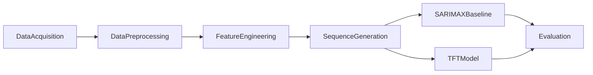

# Evaluating Temporal Fusion Transformers Against SARIMAX Baselines for 60-Day Probabilistic Price Forecasting of Continuous-Cycle Cool-Climate Crops in Sri Lanka

## Research Overview

This repository supports a university research project that compares **Temporal Fusion Transformers (TFT)** with classical **SARIMAX** baselines for **60-day probabilistic** wholesale price forecasting of continuous-cycle cool-climate crops in Sri Lanka. The work targets decision-relevant uncertainty estimates (prediction intervals / quantiles), not point forecasts alone.

The current milestone builds the observed dataset, prepares model inputs, fits both forecasting models, and evaluates them with expanding-window walk-forward validation, point and probabilistic metrics, and a Diebold–Mariano test. In the first run TFT has lower error than SARIMAX on the test split, but the difference is not statistically significant (see [Evaluation](#evaluation)).

## Research Objective

To design and evaluate a reproducible pipeline that forecasts cool-climate crop prices over a 60-day horizon, and to determine whether TFT improves probabilistic forecast quality relative to SARIMAX under walk-forward evaluation.

## Research Question

How does a Temporal Fusion Transformer compare with SARIMAX baselines for 60-day probabilistic price forecasting of continuous-cycle cool-climate crops in Sri Lanka, in terms of point-forecast error, quantile/interval quality, and statistical significance of forecast differences?

## Proposed Architecture



### Data Acquisition

Collect and organize market price series and relevant external covariates (e.g., weather or calendar signals) into `data/raw` and `data/external`. Datasets are not committed to version control.

### Data Preprocessing

Clean, merge, impute, and temporally synchronize multi-source series via modules under `src/preprocessing/`.

### Feature Engineering

Construct lag, rolling, and calendar/temporal features, then normalize predictors using stubs under `src/features/`.

### Sequence Generation

The `prepare` stage (`src/features/prepare_model_data.py`, `src/features/windows.py`) drops the warm-up rows, fits Min-Max on training rows only, and cuts sliding windows: a 90-day encoder and a 60-day decoder, with origins one day apart. Each window is assigned to the split that holds its whole decoder. Settings are in `configs/config.yaml` (`forecast`, `features`); see `docs/dataset.md`.

```bash
python -m src.main                    # build, prepare, sarimax, tft, walkforward, evaluate
python -m src.main --stages prepare   # re-scale and re-window an existing panel
```

### Forecasting Models

```bash
python -m src.main --stages sarimax tft
```

- **SARIMAX** (`src/models/sarimax/`): one model per crop on log price. Differencing is chosen by an ADF test and the order by AIC over the config grid (weekly seasonal period), on training rows only. Fitted parameters are re-applied at each forecast origin. Log-normal q10/q50/q90.
- **TFT** (`src/models/tft/`): one PyTorch Forecasting model across crops, 90-day encoder, 60-day decoder, quantile loss at 0.1/0.5/0.9. Days without a quote get zero loss weight. Early stopping on the validation windows.

Both write the same forecast table, one row per crop, forecast origin, and target day, to `artifacts/forecasts/{sarimax,tft}_forecasts.csv` (schema in `src/models/forecast_output.py`). Checkpoints, order selection, and training logs go to `artifacts/models/`. Both folders are gitignored.

### Evaluation

```bash
python -m src.main --stages walkforward evaluate
```

- **Walk-forward** (`walkforward` stage): over the test split, both models are re-estimated every 30 days on an expanding window (refits on 2025-08-17, 2025-09-16, 2025-10-16). Each model then forecasts 60 days from every daily origin. SARIMAX keeps its training-split order; TFT keeps its hyperparameters and trains for the epoch count picked on validation.
- **Metrics** (`evaluate` stage): MAE, RMSE, MAPE of q50; pinball loss per quantile and averaged; PICP and width of the q10–q90 interval. Only days with a real quote are scored. Reported pooled, per crop, and per horizon bucket, for the walk-forward forecasts and for the train-only forecasts of the `sarimax` and `tft` stages.
- **Diebold–Mariano**: TFT vs SARIMAX on absolute error and pinball loss, one loss per forecast origin, 59-lag long-run variance, Harvey–Leybourne–Newbold correction, alpha = 0.05.

Outputs go to `artifacts/evaluation/` (`metrics.csv`, `metrics_by_horizon.csv`, `diebold_mariano.csv`, `summary.md`, `plots/`). Details: `src/evaluation/README.md`.

First run, walk-forward test split, three crops pooled:

| Model | MAE | RMSE | MAPE % | Quantile loss | PICP (nominal 80%) |
|-------|-----|------|--------|---------------|--------------------|
| SARIMAX | 74.4 | 117.4 | 44.1 | 24.26 | 0.79 |
| TFT | 61.9 | 107.0 | 27.6 | 20.07 | 0.73 |

The Diebold–Mariano test does not reject equal accuracy (absolute error p = 0.50, pinball p = 0.65), nor for any single crop. The test split holds only about two non-overlapping 60-day periods, so the test has little power. TFT intervals are narrower but under-cover at long horizons.

## Planned Tech Stack

| Component | Library |
|-----------|---------|
| Language | Python |
| Data | Pandas, NumPy |
| Classical forecasting | Statsmodels |
| Deep learning | PyTorch, PyTorch Forecasting, Lightning |
| ML utilities | Scikit-learn |
| Visualization | Matplotlib |
| Config / UX | PyYAML, tqdm, Jupyter |

## Project Structure

```text
crop-price-forecasting-tft/
├── data/                  # Raw, processed, and external datasets (gitignored contents)
├── notebooks/             # Reserved for EDA and experiment notebooks
├── src/
│   ├── preprocessing/     # Cleaning, merging, missing values, time sync
│   ├── features/          # Lag, rolling, temporal, normalization features
│   ├── models/
│   │   ├── sarimax/       # SARIMAX baseline
│   │   ├── tft/           # Temporal Fusion Transformer
│   │   ├── forecast_output.py  # Forecast table shared by both models
│   │   └── train.py       # sarimax / tft pipeline stages
│   ├── evaluation/        # Walk-forward refits, metrics, Diebold–Mariano test
│   ├── utils/             # Logging and helpers
│   └── main.py            # Pipeline entrypoint (build, prepare, sarimax, tft, walkforward, evaluate)
├── configs/               # Experiment configuration (YAML)
├── docs/                  # Architecture and methodology notes
├── README.md
├── requirements.txt
├── pyproject.toml
├── LICENSE
└── .gitignore
```

| Path | Role |
|------|------|
| `data/` | Dataset storage; see `data/README.md` |
| `notebooks/` | Exploratory analysis workspace |
| `src/preprocessing/` | Reproducible cleaning and alignment |
| `src/features/` | Feature construction templates |
| `src/models/` | SARIMAX and TFT training and forecasting |
| `src/evaluation/` | Walk-forward validation, metrics, significance tests |
| `src/utils/` | Shared utilities |
| `configs/` | Hyperparameters and path defaults |
| `docs/` | Research architecture and methodology |

## Current Progress

- [x] Repository created
- [x] Folder structure
- [x] Configuration and packaging (`config.yaml`, `pyproject.toml`, `requirements.txt`)
- [x] Data preprocessing module (cleaning, deduplication, covariate imputation, daily alignment)
- [x] Feature engineering module (lags, rolling stats, calendar/monsoon features, train-only scaling)
- [x] Observed dataset build: CBSL daily Dambulla wholesale target with weather, rainfall, fuel, and FX covariates (`python -m src.main --stages build`, see `docs/dataset.md`)
- [x] Model inputs: column roles, train-only Min-Max scaling, horizon-lagged SARIMAX exogenous inputs, 90/60-day sliding windows (`python -m src.main --stages prepare`)
- [x] Evaluation module: MAE, RMSE, MAPE, pinball loss, PICP, Diebold–Mariano with HLN correction
- [x] Documentation (`docs/`, model and evaluation READMEs)
- [x] SARIMAX implementation: ADF + AIC order selection per crop, 60-day log-normal quantile forecasts (`--stages sarimax`)
- [x] TFT implementation: quantile TFT with observed-day loss weights and early stopping (`--stages tft`)
- [x] Training pipeline: both models forecast every validation and test window into one shared table
- [x] Evaluation experiments: expanding-window walk-forward over the test split, metric tables, DM tests, plots (`--stages walkforward evaluate`)

## Future Work

1. Acquire and document Sri Lankan cool-climate crop price series and covariates.
2. Implement preprocessing and feature pipelines end-to-end.
3. Build sequence generation and chronological train/validation/test splits.
4. Implement SARIMAX probabilistic baselines.
5. Implement TFT training/inference with Lightning and PyTorch Forecasting.
6. Run walk-forward evaluation, compute metrics, and apply Diebold–Mariano tests.
7. Document results for the research report / paper.

## Project Team

W M I Indrajith Madusanka
Student ID: ITBIN-2313-0059

A M Piumini Abeysinghe 
Student ID: ITBIN-2313-0002

## License

This project is licensed under the [MIT License](LICENSE).
