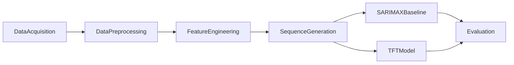

# System Architecture

This document describes the software architecture for the crop price forecasting research repository. Data build, input preparation, both forecasting models, walk-forward validation, and evaluation are implemented.

## Pipeline Overview

## Stages

### 1. Data Acquisition

Sources are collected into:

- `data/raw/` — market prices
- `data/external/` — covariates

Raw files remain outside version control.

### 2. Data Preprocessing (`src/preprocessing/`)

Responsibilities:

- Cleaning and deduplication
- Dataset merges and date alignment
- Missing-value handling
- Temporal synchronization / daily resampling

### 3. Feature Engineering (`src/features/`)

Responsibilities:

- Lag features
- Rolling-window statistics
- Calendar / temporal encodings
- Train-only normalization / scaling

### 4. Sequence Generation (`src/features/prepare_model_data.py`, `src/features/windows.py`)

Convert engineered panels into forecast windows using:

- Look-back `window_size` (90 days)
- Forecast `horizon` of 60 days

Configured in `configs/config.yaml`.

### 5. Forecasting Models (`src/models/`)

| Model | Role | Location |
|-------|------|----------|
| SARIMAX | Classical probabilistic baseline, one per crop | `src/models/sarimax/` |
| TFT | Deep probabilistic sequence model, global across crops | `src/models/tft/` |

Both write the same forecast table (`src/models/forecast_output.py`): one row per crop, forecast origin, and target day, with the observed price and q10/q50/q90.

### 6. Evaluation (`src/evaluation/`)

- Protocol: expanding-window walk-forward over the test split, both models refit every 30 days (`walk_forward_validation.py`)
- Point metrics: MAE, RMSE, MAPE
- Probabilistic metrics: quantile (pinball) loss, PICP, interval width
- Significance: Diebold–Mariano test with the Harvey–Leybourne–Newbold correction

Scored only on days with a real quote. Outputs in `artifacts/evaluation/`; see `src/evaluation/README.md`.

### 7. Entrypoint

`src/main.py` runs the stages `build`, `prepare`, `sarimax`, `tft`, `walkforward`, and `evaluate` in that order (`--stages` selects a subset).

## Configuration

Central experiment settings live in `configs/config.yaml` (paths, horizon, window size, chronological splits, random seed).

## Design Principles

- Chronological splits only (no random shuffles across time)
- No leakage from future into features or scaling
- Reproducible seeds and versioned configuration
- Clear separation between baseline (SARIMAX) and deep (TFT) code paths
